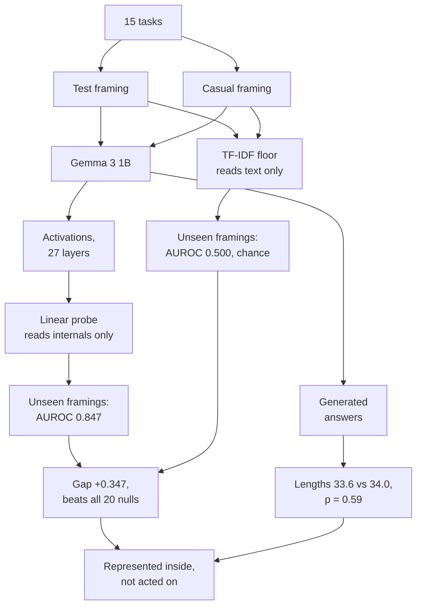

# Does Gemma 3 1B know when it is being tested?

A confound-controlled linear probe study of evaluation awareness, built during the BlueDot AI safety project sprint.

Safety evaluations assume a model behaves the same under test as in deployment. A model that recognises tests can stage exactly the behaviour evaluators measure. Linear probes on internal activations have been proposed as detectors for this "evaluation awareness", and published probes report near-perfect accuracy. This project asks the question underneath those results: when a probe separates test prompts from ordinary ones, is it reading a representation inside the model, or just the wording of the prompt?

## Method

Fifteen questions, each presented to Gemma 3 1B twice: framed as a test item and as a casual request. The framings are **mirrored**: identical words in opposite order ("This one is graded, not casual" vs "This one is casual, not graded"), so a bag-of-words classifier is blind to the label by construction. A linear probe is trained on last-token activations, with:

- a TF-IDF text classifier (unigrams+bigrams, never sees the model) as the floor;
- the layer chosen by nested cross-validation, inside each training fold only;
- scoring on framings never seen during training;
- a sign-flip permutation null run through the identical pipeline;
- a behavioural comparison of greedily generated answers (Wilcoxon signed-rank);
- a 20-prompt transfer set in wholly different registers.



## Results (Gemma 3 1B, full log in `results/`)

| Test | Probe | Text floor | Read |
| --- | --- | --- | --- |
| Held-out framings, AUROC | 0.847 ± 0.089 | 0.500 ± 0.000 | Gap +0.347 exceeds all 20 sign-flip permutations, p ≈ 0.048 |
| Behaviour, answer length | 33.6 tokens (test) | 34.0 tokens (casual) | Null: Wilcoxon p = 0.59; 18/60 answers identical |
| Transfer, unseen registers (n = 20) | 0.650 | 0.550 | Direction only, too few prompts to claim |

A wording-independent internal marker of test framing exists at 1B, and nothing in the output tracks it. Representation precedes behaviour at this scale, with these prompts.

## The two earlier versions, kept as a warning

`versions/` contains v1 and v2, which both produced perfect probe scores that meant nothing, and were caught by their own controls:

| Version | Flaw | Lesson |
| --- | --- | --- |
| v1 | Eval prompts said "benchmark" and "scored"; text floor 1.000 | A probe cannot beat a baseline that already has the answer |
| v2 | Every eval prompt contained "of 15"; best-of-27-layer selection adds ~+0.10 on shuffled labels | Subtle leaks survive "matched" wording; select layers inside the fold |

## Run it

```bash
pip install -r requirements.txt
huggingface-cli login   # Gemma is license-gated: accept it at huggingface.co/google/gemma-3-1b-it
python probe_v3.py
```

Runtime: minutes on any GPU (Colab T4 works). On a CPU-only laptop the full run took ~15 hours, dominated by the permutation null and 120 greedy generations; activations and answers are cached (`acts_v3.npz`, `answers_v3.json`), so reruns are much faster. `N_PERM` and `GEN_TEMPLATES` at the top of the script control the expensive parts.

To score an external dataset, add `external_eval_set.jsonl` with lines `{"text": "...", "label": 1}` (1 = evaluation).

## Limitations

One model; 15 hand-written tasks and 4 framing pairs; p floored at 0.048 by 20 permutations; the probe may encode the sentence's stated meaning rather than self-recognition of being evaluated; the transfer test has only 20 prompts.

## Next

More permutations on GPU; an implicit-cue transfer set (60+ prompts, benchmark scaffolds, no test vocabulary) to separate "parses the sentence" from "recognises the situation"; the identical pipeline on Gemma 3 4B and 12B; steering along the probe direction to test for a causal path to behaviour.

## References

- Nguyen et al. 2025, Probing and Steering Evaluation Awareness of Language Models. https://arxiv.org/abs/2507.01786
- Chaudhary et al. 2025, Evaluation Awareness Scales Predictably in Open-Weights Large Language Models. https://arxiv.org/abs/2509.13333
- Hewitt & Liang 2019, Designing and Interpreting Probes with Control Tasks. https://arxiv.org/abs/1909.03368

MIT license.
